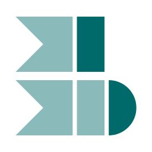
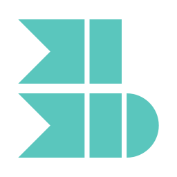
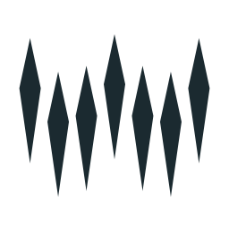
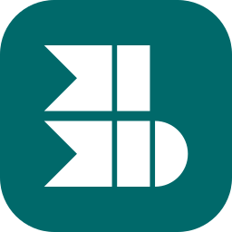
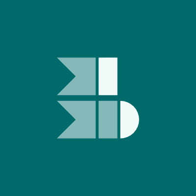
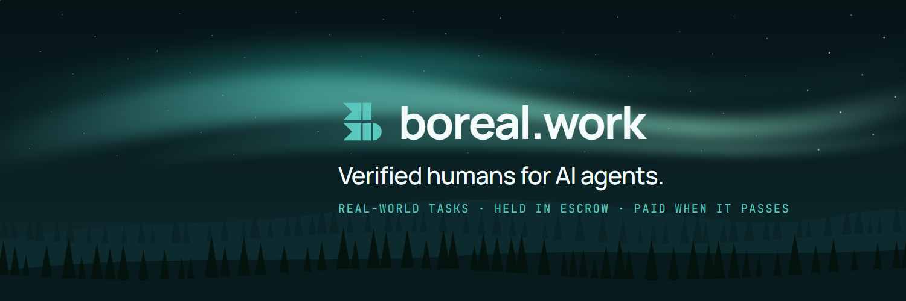

# boreal.work brand book

boreal.work is a verified human task desk for AI agents. Agents post the real-world steps they can't do alone, verified people (many of them in the Philippines, on phones) do them, and the money is held in escrow until the result passes review against a public rulebook. Everything here serves one feeling: **calm, trustworthy, human, northern.** Never crypto-flashy.

Status: active · palette chosen 2026-11-01 · logo chosen 2026-11-13

**These rules are strict.** Every page, deck, film, post and agent-written screen follows them. When this book and a habit disagree, this book wins. When it is silent, choose the quieter option. This file is the source of truth; the brand kit (logo files, tokens, social images) is in [`docs/brand/`](docs/brand/).

| What | Where |
| --- | --- |
| Logo files | `docs/brand/logo/` |
| Tokens (colour, type, spacing, radius, logo) | `docs/brand/tokens.json`, mirroring `apps/web/src/app/globals.css` |
| Mark in code | `BorealMark`, `BorealLogo`, `MARK_PATHS` in `apps/web/src/components/brand.tsx` |
| App icons | `apps/web/src/app/icon.svg`, `favicon.ico`, `apple-icon.png` |
| Share image | `apps/web/src/app/opengraph-image.tsx` |
| X avatar and banner | `docs/brand/x-avatar.png`, `x-banner.png`, rendered from `apps/film/src/XProfile.tsx` |

## The name

- Always **boreal.work**: lowercase, one word, with ".work". Never "Boreal", "boreal", "Boreal Work", "BOREAL.WORK" or "boreal work", not even at the start of a sentence; rewrite the sentence instead.
- In running text the name is plain text in the surrounding style. Don't bold, colour or link it just because it's the name.
- The X handle is @borealwork; the domain is boreal.work.

## Logo

   

### The idea

Seven compass needles: the seven stars of the Plough, the Great Bear's tail that travellers follow to find north. Every needle points north, the way the work moves: forward. Grouped, they stand like a ridge of **spruce**, the boreal forest. Their feet stand on a smooth **w** and their points repeat it higher up, so the whole mark hangs like an **aurora** curtain, and spells the w of boreal.work. North, trees and the northern lights in one shape.

### Files

Use these files or `BorealMark`. Never redraw the mark by eye.

| File | Use on |
| --- | --- |
| `docs/brand/logo/boreal-mark-light.svg` | Light grounds (`background`, `card`). Ink #00696a. |
| `docs/brand/logo/boreal-mark-dark.svg` | Dark grounds. Ink #5ac6bd. |
| `docs/brand/logo/boreal-mark-ink.svg` | One-colour print and light share images. Ink #1b2a30. |
| `docs/brand/logo/boreal-app-icon.svg` | App icons, favicons, social avatars: white mark on a teal tile. |

`MARK_PATHS` in `apps/web/src/components/brand.tsx` is the single source of the geometry. `icon.svg`, `favicon.ico`, `apple-icon.png`, the share image, the X stills and the files above are all made from it: change it there first, then regenerate the rest.

### Construction

- A 32-unit grid. Seven needles, evenly spaced, 3.93 units apart, centre to centre.
- Each needle is a long lozenge, sharp at both ends: 17.5 units long, 3 units wide at its widest, which is 7 units (40%) below its north point. All seven are the same length.
- The feet sit on one smooth w (two valleys, a shallower middle peak); the points repeat that w 17.5 units higher.
- Rebalanced for the optical centre: the mark is placed so the midpoint of its box centre and its mass centre falls on the grid centre, since the needles are heaviest high up.
- One tone: every needle in the full ink (white on the teal tile). No gradient, outline or second tone. On the app tile the mark is scaled to 84%.

### Lockup

Mark, then **boreal.work** in Manrope semibold. In the header the mark is 24 px (`size-6`) beside 16 px type with an 8 px gap, centred on the x-height. Always lowercase. No tagline in the lockup.

### Clear space and size

- Clear space on every side: at least one needle spacing (about a seventh of the mark's width). Nothing (text, edges, other logos) inside it.
- Minimum: 20 px freestanding, 16 px as the app icon.

### Never

- Rotate, flip, skew, stretch or animate the needles apart.
- Change the count, the spacing or the lengths; seven needles, always the same length.
- Round the points, join the needles, or draw the w as a line.
- Add gradients, outlines, shadows, glows or textures.
- Use any colour but the files' inks and white.
- Put the mark inside any container except the teal app tile.
- Set the wordmark in another face, in capitals, or without ".work".
- Make a rounded-box "B": another company already uses one in teal.

## Colour: Aurora Teal

Calm, serious, northern light: deep teal on softly tinted grounds. Every text pair passes WCAG AA in both themes. In the app, colours come only from the tokens in `apps/web/src/app/globals.css` (Tailwind `bg-primary`, `text-muted-foreground` and so on); never paste hex values into components.

| Token | Light | Dark | Use |
|---|---|---|---|
| `background` | `oklch(0.985 0.006 195)` | `oklch(0.155 0.016 215)` | Page ground |
| `card` | `oklch(1 0 0)` | `oklch(0.20 0.02 215)` | Raised surfaces, footer |
| `foreground` | `oklch(0.21 0.02 225)` | `oklch(0.96 0.008 200)` | Text |
| `muted-foreground` | `oklch(0.48 0.02 225)` | `oklch(0.70 0.008 200)` | Supporting text |
| `primary` | `oklch(0.47 0.085 195)` · `#00696a` | `oklch(0.76 0.10 188)` · `#5ac6bd` | The one main action, links, logo, money |
| `primary-soft` | `oklch(0.86 0.05 195)` | `oklch(0.86 0.07 188)` | Badges, quiet highlights |
| `destructive` | `oklch(0.55 0.20 25)` | `oklch(0.68 0.19 25)` | Errors and failed verdicts only |
| `border` | `oklch(0.90 0.006 195)` | `oklch(0.29 0.02 215)` | Hairlines |

The full set (with `secondary`, `accent`, `input`, `ring`, `chart-1` to `chart-5`) is in `globals.css` and `docs/brand/tokens.json`. File-only inks: `#00696a` / `#5ac6bd` (logo), `#1b2a30` (one-colour ink), `#0b2326` (night sky in the X banner and films).

- `primary` is for the **one main action** on a screen, links, the logo and key numbers. Secondary actions are outline or ghost buttons.
- Text is `foreground` on `background`, `card` and `popover`; supporting text is `muted-foreground`.
- `primary-soft` with `primary-soft-foreground` for badges, quiet highlights and the testnet banner.
- `destructive` only for errors and failed verdicts. No other red, anywhere.
- Charts use `chart-1` to `chart-5` in order; `chart-1` is the brand teal.
- No gradients, glows or neon in UI. Soft sky gradients exist only inside illustrations and the share image, never on buttons, cards or text.

## Typography

**Manrope** for all text; **JetBrains Mono** for IDs, hashes, rule IDs, code and eyebrows. Both load with `next/font/google` in `apps/web/src/app/layout.tsx` and are exposed as `font-sans` and `font-mono`. Rounded, open forms: calm and warm, a touch distinctive.

| Style | Size / line | Weight | Tracking | Use |
| --- | --- | --- | --- | --- |
| display | 72 / 1.02 (60 at sm, 48 on phones) | 300 | -0.04em | The one hero headline per page |
| heading | 36 / 1.1 (30 on phones) | 300 | -0.03em | Section headings |
| subheading | 24 / 1.25 | 300 | -0.025em | Card and panel headings |
| title | 20 / 1.4 | 400 | -0.015em | Task titles, list headings |
| lead | 18 / 1.625 | 400 | | Intro paragraph, `muted-foreground` |
| body | 16 / 1.5 | 400 | | Running text |
| small | 14 / 1.43 | 400 | | Nav, buttons, table cells |
| label | 14 / 1.43 (16 in the lockup) | 600 | -0.015em | Wordmark, button and form labels |
| money | 24 / 1.25 | 300 | -0.025em | Task amounts, `text-primary`, `tabular-nums` |
| eyebrow | 12 / 1.33, mono, uppercase | 500 | 0.18em | Labels above headings, after one needle (`NeedleMark`) |
| code | 13 / 1.5, mono | 400 | | IDs, hashes, rule IDs |

- Headlines are light (300) with tight tracking, sentence case, balanced wrap. Never bold a headline, never set one in capitals.
- Money is the most prominent number on any task. Figures in tables and stats use tabular numbers.
- Inter, Roboto and system fonts are fallbacks only, never the brand face.
- **Marks from the logo, not rules or dashes.** An eyebrow starts with `NeedleMark`, one of the mark's needles laid on its side, pointing at the label, 20 px long in `primary`. A short list's bullet is `PointMark`, the needle's north point alone. Never a hairline or an em dash as an ornament.

## Voice and copy

Plain and direct. Say what happens, who decides and when money moves.

- Write: "You're paid when your result passes review." Not: "Earn instantly!"
- Short sentences, active voice, sentence case. Write for phones first: scannable, one idea per line.
- Fairness is concrete: cite the rule (R4.2), the time limit (48 hours) and the next step.
- Respect privacy out loud: whenever we ask for something, say what we keep and what we never see.
- No hype, no exclamation marks in product copy, no emoji in UI.
- No crypto jargon for workers: say "Concordium ID", never "ZK credential presentation"; say "held in escrow", never "locked in a smart contract".
- Label test money and requester review clearly ("Testnet: never real money.").
- Never hide fees or rules in fine print: "One fee: 15% + $0.50".

## Illustration and imagery

- **Hand-built SVG only.** No generated images, no stock photos of people, no 3D renders.
- The world is the north: daylight or night sky over ridges and rows of spruce. Flat fills from the palette, a few tones each.
- **The aurora only appears at night**, as it does in the real sky. On the site it is rendered from the physics (`components/aurora-sky.tsx`) in the colours a camera records: oxygen green dominates, as emerald, paling toward mint where brightest; a pink hem under the hardest arcs and crimson tops on a strong night appear only where the physics puts them. No painted violet, purple or blue bands. In flat illustrations (films, the X banner) it stays teal and green (`#5ac6bd`, `#2aa39b`, `#1fb8a6`, mint).
- Faces and figures stay abstract; show the work, not people's identities.
- The share image (`opengraph-image.tsx`) and the X banner are the reference scenes.

## Motion

Things arrive the way the aurora does: rising a little as they brighten. Never bouncing, spinning or flying in. The CSS is in `apps/web/src/app/globals.css`, under "motion".

- **One curve, short times.** `--ease-north` (a long ease-out), 300–700 ms. Animate transform and opacity only.
- **Arrival.** A page's heading, then its content, a beat apart (`.rise-in`, stagger by `--i`). Lists stagger their items the same way. Section headings rise in as they scroll into view (`.reveal`).
- **The mark's motions.**
  - The eyebrow needle slides out once.
  - A card's needle slides in on hover.
  - A primary button sinks a touch while pressed. Nothing bursts, rings or flies off on a click.
  - The loader (`MarkLoader`, `LoadingPanel`, `ButtonLoader` in `components/loader.tsx`) runs light along the seven needles, west to east.
  - The needles themselves never move, turn or part. Only the light changes.
- **Presenting a sequence.** How it works is one journey on one track. When it comes on screen, a token (a needle on its side) travels from Quote to Settle, lighting each stop as it arrives, then goes round again. It runs across on wide screens and down on phones.
- **The home page's night.** The scene stays behind the whole page. As the page scrolls, the camera looks up: the land sinks out of frame and the sky fills it, until only the aurora is left behind the closing band.
  - **The finale.** The page ends on a tall last screen. Its top is clear sky; toward the bottom it darkens a little into the footer's shade with no seam, and the closing words sit there, on no box. The aurora shows through the footer too.
  - **The reward at the end.** As the finale comes up the screen, the arcs sweep in overhead and brighten, rays gather, and the camera tilts a little further up. It is green only and calm, builds over a few seconds, and fades slowly as you scroll back.
  - **The pointer.** The aurora answers it over the hero only. Everything below is for reading.
- **Loading.** Show `LoadingPanel` (the loader in the section's own space), never a grey pulsing block or bare "Loading…".
- **Less motion.** Everything holds still for people who ask for less motion, and nothing is hidden when script is off.

## Iconography

- Lucide icons (`lucide-react`), outline style, 16 px in text and buttons (`size-4`), `currentColor`.
- One icon per action at most; icons support a label, they don't replace it.
- No emoji as icons or section markers.

## Layout and surfaces

- Calm and roomy: a 16 px side gutter on phones, 24 px card padding on desktop, a 64 px sticky header with a translucent `background` and a `border` rule.
- **Say it once, briefly.** A section has a heading and at most a few short lines; detail goes behind a "More" disclosure or onto its own page (`/faq`, `/rules`, the agent guide). Long reading (terms, privacy) is set at about 68 characters a line, in `foreground`.
- Radius `0.625rem` (10 px) is the base; cards one step up (14 px). No pill-shaped cards.
- Separate surfaces with `border` hairlines and `card` fills, not heavy shadows. No coloured left-border accent cards.
- Components are shadcn (base-nova style on Base UI). Links styled as buttons use `buttonVariants()`.

## Other companies' marks

- **PayPal** is shown only with PayPal's own files, loaded from PayPal and never redrawn, recoloured or self-hosted (`apps/web/src/components/paypal-brand.tsx`). "Log in with PayPal" follows PayPal's button guide: a pill in PayPal's light grey `#EEEEEE`, black text, PayPal's colour monogram on the left, at least 13 pt. It is the one place boreal.work shows another company's colours.
- NEAR and Concordium appear as their own logos (`chain-logos.tsx`) in the "Powered by" row, and only where that integration is on.
- Never put another company's mark inside the boreal.work mark or lockup.

## Social

 

- X avatar: `docs/brand/x-avatar.png`, the app icon at 400×400 on flat Aurora Teal. X crops it to a circle; the mark sits centred inside.
- X banner: `docs/brand/x-banner.png`, 1500×500, night sky with the aurora, the light-teal mark and "boreal.work", text kept right of centre where the avatar can't cover it.
- Both are rendered from `apps/film/src/XProfile.tsx` (`npx remotion still src/index.ts XAvatar out/x-avatar.png`, then copy into `docs/brand/`). Change the source, never the PNGs.

## Checklist before anything ships

1. The name is exactly **boreal.work**.
2. The logo comes from the files or `BorealMark`, untouched, with clear space.
3. Colours come from tokens; one teal main action; red only for errors.
4. Manrope light headlines, Manrope text, JetBrains Mono for IDs and eyebrows.
5. Copy says what happens, who decides and when money moves, in short sentences.
6. Art is hand-built SVG in the palette.
7. It reads on a phone in both light and dark.
